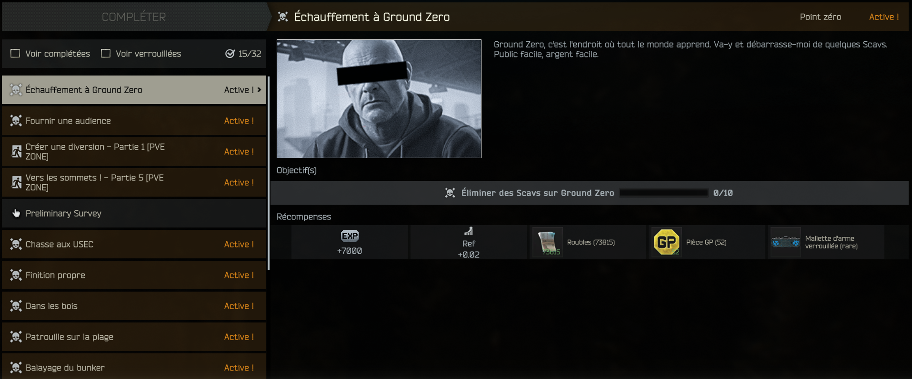
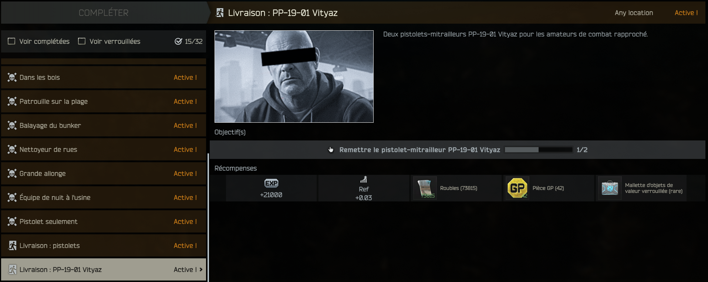

# 🎯 Ref Extra Quests 1.7.1

**135 extra quests for Ref (the Arena trader) in SPT 4.1.x.** A long, level-gated quest line with unusual objectives, and texts in 16 languages.

  



## ✨ What you get
- **135 quests** for Ref. The first quest is available from level 10, with no Ref prerequisite.
- **One quest line per map**: Customs, Woods, Shoreline, Reserve, Lighthouse, Streets of Tarkov, Ground Zero (from level 11), Factory, Labs and Labyrinth. The lines unlock after the first quest, so you pick the order.
- **Unusual objectives**: weapon-type challenges (pistol only, SMG, shotgun, marksman rifle, bolt-action, machine gun, grenades), Rogues, Raiders, night Cultists, and **3-extractions-in-a-row streaks**.
- **23 "Delivery" quests**: hand weapons over to Ref (roubles + GP rewards, any attachments allowed).

  

- **"Legend of Ref"** has extra objectives: headshots, long range, night kills and any boss.
- **Original chain**: Scav, BEAR, USEC and PMC hunts, extractions.
- Rewards: XP, roubles, dollars or euros, GP coins and Ref reputation, scaled to the quest level. The hardest quests give a **Lega Medal**, the others an **Arena crate**.

## 🌍 Languages
English, Français, Русский, Deutsch, Español (ES + LATAM), 中文, 日本語, 한국어, Polski, Português, Čeština, Türkçe, Italiano, Magyar, Română, Slovenčina.

The mod uses your SPT language automatically. English is the fallback.

> Translations are machine-style and may contain mistakes. Spotted one? Open an issue, corrections are welcome.

## 📦 Compatibility
- SPT 4.1.x
- **acidphantasm-reffriendlyquests** is **not required**, but the two mods work very well together.
- Arena crates are base-game items. The BoxesAtRef mod is compatible and sells them at Ref.

## 🔧 Installation
Copy the `SPT_Runtime` folder into your SPT folder (it merges with the existing one):

```
SPT_Runtime/user/mods/RefExtraQuests/
```

**Updating from an older version:** replace the `RefExtraQuests` folder. Quest IDs are unchanged.

## ⚠️ Before you play
Back up your profile first (`SPT/user/profiles/<your_id>.json`). Once a quest is accepted it is written in the profile, so do not remove the mod afterwards.

## 📝 Changelog
### 1.7.1
- All new quest texts translated into the 15 other languages.

### 1.7.0
- 15 new quests: weapon challenges, Rogues / Raiders / Cultists, 3-extractions-in-a-row streaks.
- Ground Zero quests now form their own chain from level 11.
- "Legend of Ref": extra objectives (headshots, long range, night, any boss).
- 23 "Delivery" quests (roubles + GP).
- Rewards: Lega Medal on the hardest quests, Arena crates on the others.

### 1.6.x
- New quest chains for Ground Zero, Factory, Labs and Labyrinth.

### 1.5.3 / 1.5.2
- GP rewards halved (rounded to tens).
- Map-name fix (case-sensitive IDs): Ground Zero, Woods, Shoreline, Interchange, Lighthouse, Reserve and Streets quests now progress correctly.

### 1.5.0
- Quest texts translated into 15 more languages, all in one package.

### 1.4.0
- 44 new quests (Customs, Woods, Shoreline, Reserve, Lighthouse, Streets of Tarkov, special orders).
- First quest now available from level 10.
- Rouble rewards on the original quests halved.

## 🐞 Feedback
Found a bug or a translation mistake? Open an issue.

## 📄 License
MIT - by PraED_TV
